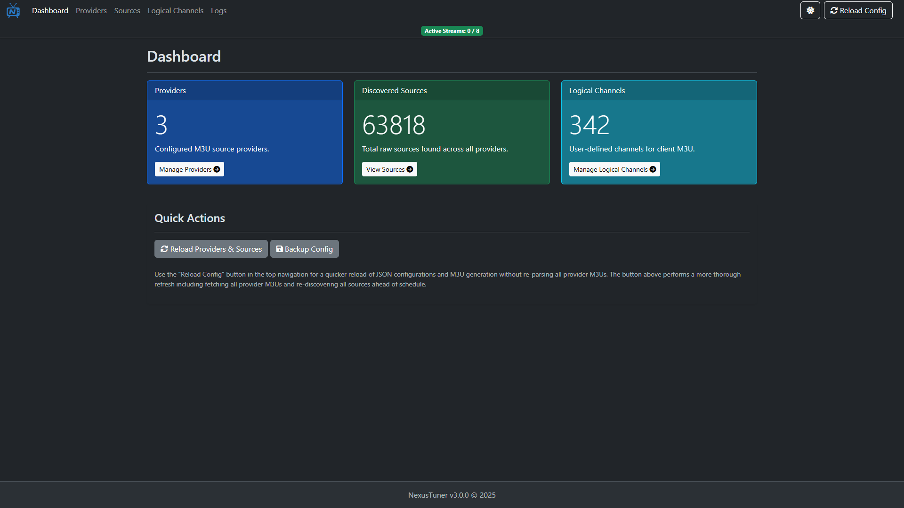
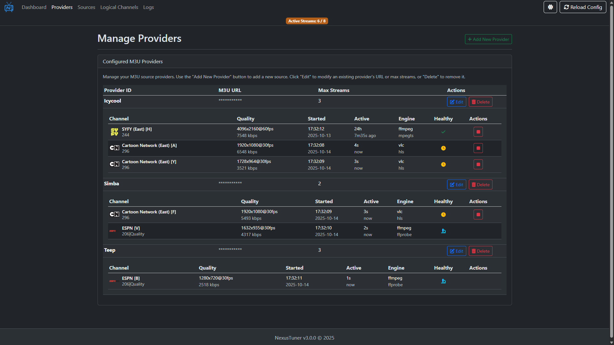
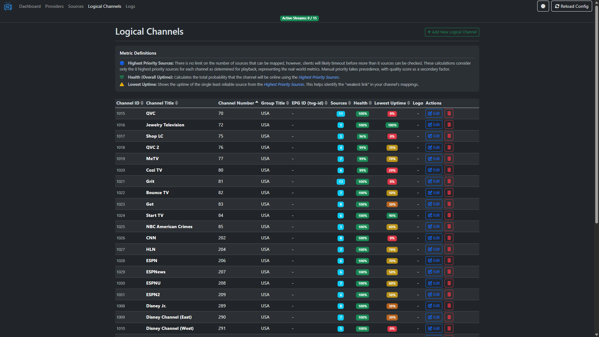
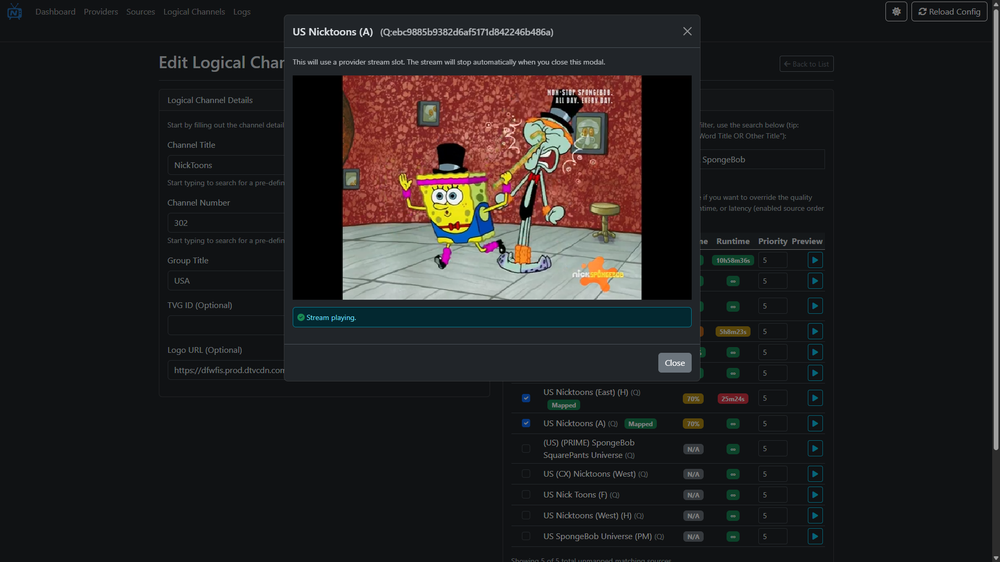
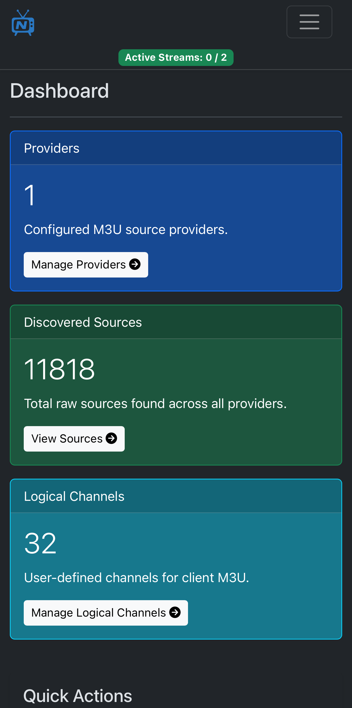

# NexusTuner

[](https://github.com/Fahmula/nexus-tuner/releases/latest)
[](https://github.com/Fahmula/nexus-tuner/blob/main/LICENSE)

`NexusTuner` is a smart, self-hosted IPTV proxy that aggregates multiple M3U sources into a single, stable, and feature-rich playlist for your media clients.

> [!TIP]
> **Key Features:**
> * **Web-Based UI:** A modern, user-friendly UI with PWA support to manage providers, create logical channels, map sources, and view application logs. Mapping channels has never been easier with automatic suggestions and prefilled data to make the setup process frictionless. Additionally, sources mapped to other logical channels will be marked as `In Use` or `Duplicated` if it's also mapped to the current channel.
> * **M3U Aggregation:** Combine multiple IPTV provider playlists into one unified and consistent channel lineup. Each provider can be configured with their maximum concurrent streams, which `NexusTuner` will manage intelligently.
> * **`In-Browser Previews:`** Easily preview streams directly in your browser while configuring channels or from the `Sources` page. No more guesswork and fiddling with external players to check stream region and language.
> * **`Automatic Quality Monitoring:`** `NexusTuner` continuously monitors the health of each source along with its resolution, bitrate, and framerate. No more endless tinkering to find the best source, just select them all and `NexusTuner` automatically chooses the highest quality and most reliable stream from your configured sources when a channel is requested. Additionally, you can use metrics such as `Uptime`, `Runtime`, and `Offset (Relative Delay)` from your sources so you can curate the perfect viewing experience.
> * **`Fast & Reliable Streams:`** When a channel is requested, `NexusTuner` starts multiple mapped sources in parallel (respecting each provider's limit). It then quickly selects the best healthy stream based on priority and quality, leading to faster, more reliable, and more consistent channel startup times. Additionally, it will automatically switch to another source if the current one fails, ensuring uninterrupted viewing.
> * **`Dead Source Detection:`** Once configured, your channel lineup remains stable and consistent to your media clients, even if you completely change Providers or remove all source mappings. Additionally, `NexusTuner` automatically detects dead mapped sources (e.g. stream url changed) and intelligently tries to remap them based on their tvg data. If it's not possible, channels with dead sources will be logged and marked in the UI with a convenient button to remove them. In any case, you will never need to remap a channel in your media clients unless you've deleted the logical channel itself.
> * **`On-the-Fly Remux:`** All streams are processed via FFmpeg/VLC to produce an HLS or MPEGTS format, maximizing compatibility across a wide range of media client devices and applications. Each stream type also supports sharing the same process for multiple simultaneous connections automatically, reducing resource usage and provider slot usage.
> * **HDHomeRun Server:** `NexusTuner` can act as an HDHomeRun server, allowing you to use your IPTV channels with compatible media clients that support HDHomeRun such as Plex, Emby, Jellyfin, and more.
> * **Ghost Session Cleanup:** Integrates with Emby and Jellyfin to detect and terminate "ghost" streams, processes that are still running after a media client has disconnected improperly, freeing up valuable provider slots.


## Dashboard


## Providers


## Logical Channels


## Edit Logical Channel With Preview


## Dashboard Mobile


## Getting Started

> [!NOTE]
> This application can be run using docker or directly using python.

### Install `NexusTuner`

#### With Docker

Use the compose file and instructions provided here: [docker-compose.yml](docker-compose.yml).

#### Without Docker

For non-docker users, install Python 3.14 or later and run the following commands:

```bash
git clone https://github.com/Fahmula/nexus-tuner.git
cd nexus-tuner
python3.14 -m venv venv

venv/bin/pip install -r requirements.txt      # Linux/macOS
venv\Scripts\pip install -r requirements.txt  # Windows
```

> [!IMPORTANT]
> You'll need to install FFmpeg (and optionally VLC) separately on your system, you'll be able to
> set their paths on the **Settings** page later. ffprobe will be inferred from the FFmpeg path.

### Configuring `NexusTuner`

Almost everything is configured on the **Settings** page of the web UI and saved in `settings.json` in your config directory.
Changes apply immediately without a restart. Only two environment variables are still needed to start the application:

| Variable                          | Description                                                                         | Example                              |
| :-------------------------------- | :---------------------------------------------------------------------------------- | :----------------------------------- |
| **`NEXUS_CONFIG_DIR`** (Required) | The directory where `NexusTuner` stores its configuration files. `/config` in Docker. | `/path/to/config/folder/nexus-tuner` |
| `NEXUS_PORT`                      | The port the application listens on and serves client URLs with.                   | `4040`                               |

You can set them on your system, in the docker compose file, or in a `.env` file in your config directory, see [env.example](env.example).
Docker users only need the docker compose file. Non-docker users should create a directory anywhere on their system to use as their
config directory and copy [env.example](env.example) to `config/.env`.

#### Settings Page

| Setting                       | Description                                                                                             | Default            |
| :---------------------------- | :------------------------------------------------------------------------------------------------------ | :----------------- |
| Fallback URL                  | Address without the port, only used when the address a client connected with is unknown.               | (empty)            |
| Stream Engine                 | The stream processing engine to use, `FFmpeg` or `VLC`.                                                 | `FFmpeg`           |
| FFmpeg Path                   | The path to the FFmpeg executable, ffprobe must be in the same folder.                                  | `/usr/bin/ffmpeg`  |
| VLC Path                      | The path to the VLC executable (optional).                                                              | (empty)            |
| Remove captions and subtitles | Removes subtitles from the processed streams.                                                           | Off                |
| Inactivity Timeout            | Seconds of inactivity before a stream is stopped. Inactive streams will be pruned earlier when needed.  | `900`              |
| Stream Log Retention          | How long to keep process logs in seconds.                                                               | `86400`            |
| Days of Logs Kept             | Number of days of log backups to keep.                                                                  | `7`                |
| Scheduled Backups Kept        | Number of days of config backups to keep, `0` disables them. Each backup is `<1MB` in size.             | `30`               |
| Check Interval                | Interval in seconds to check the media servers for ghost sessions.                                      | `60`               |
| Media Servers                 | Emby and Jellyfin servers to check for ghost sessions, see below.                                       | (none)             |

The application shows a warning on every page if the FFmpeg or VLC path cannot be used.

> [!WARNING]
> Backups include `settings.json`, which contains your media server API keys.

#### Media Servers and Ghost Sessions

When media servers are added on the **Settings** page, the ghost session monitor asks each enabled server what is playing and stops
streams that none of them are watching, e.g. when a client stopped watching but left its connection open.

* Add **every** Emby or Jellyfin server that watches through `NexusTuner`, including ones at other locations that use a shared
  playlist. Streams watched only on a server that is not added will be stopped.
* Channels are matched by name, keep the channel names in each server the same as in `NexusTuner`.
* If an enabled server cannot be reached, no streams are stopped until it is reachable again.
* Use **Test** to check the URL and API key. API keys are created under **API Keys** in each server's dashboard.

#### Upgrading From Environment Variables

Earlier versions were configured with environment variables such as `NEXUS_URL`, `NEXUS_FFMPEG_PATH` and `NEXUS_EMBY_URL`. On the first
start after upgrading, their values are copied into `settings.json` automatically, after that they are ignored and can be removed.
An Emby or Jellyfin URL without an API key is added as a disabled server.

### Run `NexusTuner`

#### With Docker

Run the application using the docker-compose.yml:

```bash
docker compose up -d
```

#### Without Docker

> [!IMPORTANT]
> Ensure you are in the directory you cloned earlier that contains `app.py`.
> You do not need to activate the virtual environment for running the application.

Run the following command, replacing `NEXUS_PORT` and `NEXUS_CONFIG_DIR` with the values you set in your `.env` file:

```bash
venv/bin/uvicorn app:app --workers 1 --log-level warning --host 0.0.0.0 --port NEXUS_PORT --env-file "NEXUS_CONFIG_DIR/.env"
```

Schedule `NexusTuner` to run on startup using your system's service manager (e.g. systemd, launchd, Task Scheduler).

### Configuring Channels

> [!TIP]
> On your IPTV service, select all the channels that correspond to the regions and languages you want to include in your unified playlist.
> You will map specific sources to your configured logical channels in `NexusTuner`, perform only the bare minimum filtering on your IPTV
> service (e.g. only US channels) for the best experience.

* Open a web browser and navigate to your server's address and `NEXUS_PORT` (e.g. `http://192.168.1.100:4040`).
* Check the **Settings** page, e.g. to set the FFmpeg path or add your Emby and Jellyfin servers.
* Navigate to the **Providers** page and add your M3U source providers.
  * Return to the Dashboard and click `Reload Providers & Sources` to discover the sources from your configured providers.
* Navigate to the **Logical Channels** page to create your desired channel lineup.
  * As you type in the channel name or number, `NexusTuner` will display suggestions to prefill the channel data.
  * You can map as many sources as you like. You can also preview each source to ensure they are correct.
  * If a source is mapped to another logical channel, it will be marked as `In Use` or `Duplicated` if it's also mapped to the current channel.
  * **Save & Analyze Mappings** probes quality and measures relative audio offsets for this channel. Audio analysis runs only when requested manually, usually takes about five minutes, and continues after leaving the page. Reopen the channel to see its status and results. The fastest measured source has offset zero; unmatched sources keep their existing values.
  * Audio offset measurement needs overlapping programme audio and available provider slots. Each direct comparison searches up to two minutes apart. Unreliable sources are retried with changing references for up to 30 minutes; confirmed results are saved as sources join the measured group.

### Configuring Your Media Clients

> [!NOTE]
> `NexusTuner` supports unlimited simultaneous streams for the same channel, even if your media client does not support it natively. Also, if a source dies during viewing, it will automatically failover to the next best source.

The best way to use `NexusTuner` is through the `HDHomeRun` interface, which is supported by many media clients including Plex, Emby, and Jellyfin.
`NexusTuner` should automatically be detected by your media client applications if they are on the same network. Otherwise, follow the instructions
for your specific media client application to add an `HDHomeRun` tuner by specifying your server's address and `NEXUS_PORT`.

`NexusTuner` also provides a standard M3U playlist that can be used in any media client application that supports it. For an application
like VLC, you can use the M3U playlist URL: **`http://<server address>:<NEXUS_PORT>/playlist.m3u`**

### Updating `NexusTuner`

#### With Docker

Pull the latest image and restart the container from the directory where you have your `docker-compose.yml` file:

```bash
docker compose pull
docker compose up -d
```

#### Without Docker

Pull the latest changes using git and reinstall the requirements from the nexus-tuner directory cloned earlier:

```bash
git pull
venv/bin/pip install -r requirements.txt      # Linux/macOS
venv\Scripts\pip install -r requirements.txt  # Windows
```

## Development

Contributions are welcome! This project follows the [Conventional Commits](https://www.conventionalcommits.org/en/v1.0.0/) specification for all commit messages to ensure a clear and automated versioning and changelog process.
